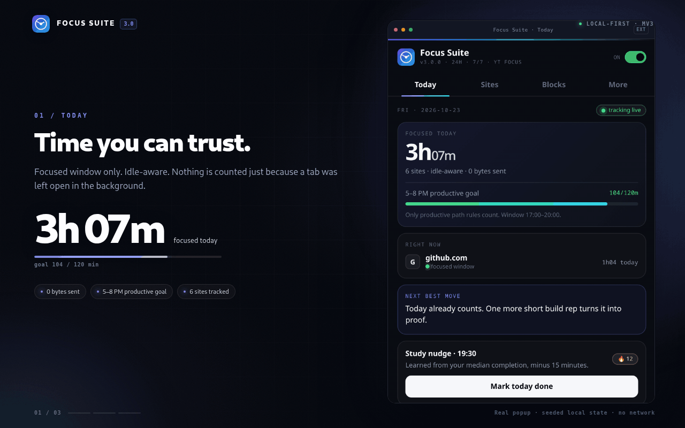
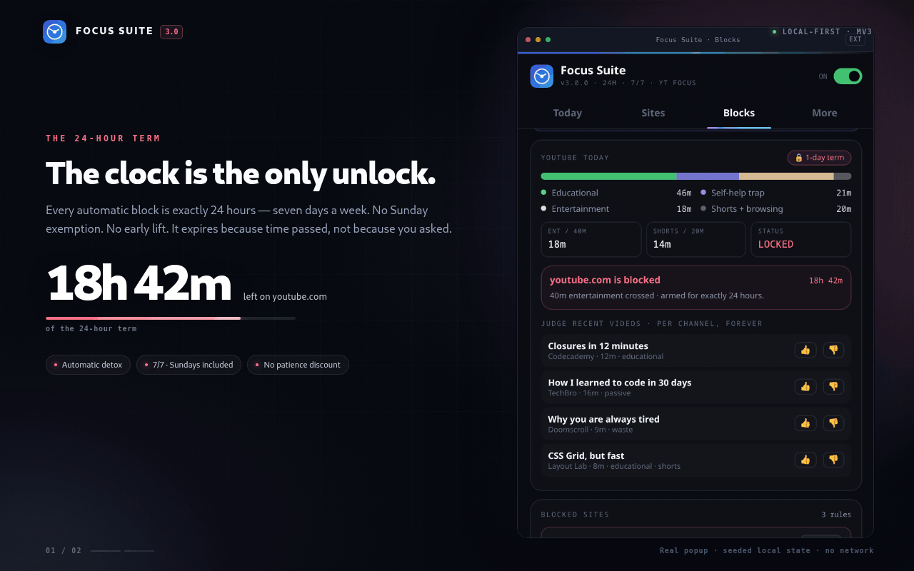

# Focus Suite 3.0 — Time Tracker + YouTube Focus, in one

**Focus Time Tracker (v1.8)** and **YouTube Focus (v1.1)** merged into a single
Manifest V3 extension with one popup, one YouTube content script, one keyword
brain — and the **2.0 block policy** carried through: every automatic block is
**exactly 24 hours**, enforced **7 days a week**, and the clock is the only unlock.
The Sunday exemption is deleted.

## Demo

*The 12-second tour: real popup, seeded local state, no network.*

*The proof: the 24-hour automatic term and the YouTube Focus card, on the real popup.*

## Install (nothing to paste)

1. Unzip somewhere permanent (e.g. `~/extensions/focus-suite`). Icons are included.
2. `chrome://extensions` → **Developer mode** → **Load unpacked** → pick the folder.
3. Pin the clock icon.

### Switching over from the two old extensions

1. **Back up both folders** (`focus-tracker-backup-1.8.0`, `youtube-focus`).
2. **Disable (don't delete yet) YouTube Focus** on `chrome://extensions`, so two extensions
   don't both hide the same elements.
3. Load Focus Suite. If you are upgrading the *same folder* as Focus Tracker, replace its
   files and press **Reload** — migration is automatic (Sunday flags purged, 48h terms
   clamped to 24h, reviews/stats/rules/AI commentary kept).
4. Open YouTube once. Your old keyword lists aren't readable by another extension, so either
   keep the identical defaults or retype your custom ones in **Options** (or Import JSON).
5. After a few days, delete YouTube Focus for good.

## What merged, and how

| Concern | Tracker 1.8 | YouTube Focus 1.1 | Suite 3.0 |
|---|---|---|---|
| YouTube content scripts | analyzer + blocker | one script | **analyzer (playback) + `youtube-focus.js` (everything that changes the page)** |
| Hiding | channel videos | layout, Shorts, keywords | **one MutationObserver, one 140 ms pass, one `ytf-*` class namespace** |
| Video classification | hard-coded word lists | Allowed / Good / Blocked lists | **one brain: the same lists drive page filtering _and_ waste/edu accounting** |
| Shorts | counted as waste, 20 min limit | blocked everywhere | **blocked by default; the 20-min limit remains the backstop if you switch blocking off** |
| Settings storage | `storage.local` | `storage.sync` | **both, by purpose:** data stays local; keyword lists + toggles sync |
| UI | 4-tab popup | toolbar popup + options | **4-tab popup (YouTube Focus card in Blocks) + keyword options page** |
| Block terms | 2 days | n/a | **24 h, 7/7, no lift** |
| Permissions | tabs, storage, alarms, idle, favicon, DNR, notifications, downloads | storage | union of both (YouTube Focus adds nothing new) |
| Tests | empty stubs | 62 browser checks | **34 engine tests + 24 policy/merge checks, plain Node** |

## YouTube Focus (all on-device)

- **Home** feed hidden (replaced by a "search for what you actually need" note); masthead ads hidden.
- **Sidebar/related**, chip cloud, end screens, pause overlay, autoplay countdown, miniplayer hidden.
- **Shorts** blocked: nav, shelves, cards, channel tab, `/shorts/…` pages; links are intercepted in the capture phase so the player never loads.
- **Keyword filtering** in **Off / Balanced / Strict** on every video list.
- **Search override** — a query that matches the right list skips filtering for that results page
  (`Allowed + good` · `Allowed only` · `Never`, plus *keep hiding hard-blocked keywords*).
- **Reveal pill** on results: "🚫 N videos hidden — click to show".
- **Promos** (sponsored modules, merch, engagement-panel ads) hidden.

Matching rules (`yt-engine.js`): case-insensitive · left word boundary only (`focus` matches
"focusing", `art` does not match "smart") · multi-word keywords match spaces or hyphens ·
input is regex-escaped (`18+`, `c++`, `node.js`) · **Allowed always wins over Blocked.**

## Focus Tracker (all local)

Honest time tracking (focused window, idle-aware, sleep gaps dropped) · nightly reviews with
catch-up · **locked 24h auto-detox** · **40/20 YouTube guard (24h)** · channel blocking ·
path-level study rules + 5–8 PM goal · learned study reminder · analysis-first clear history ·
block-fire log with exact inputs · opt-in numbers-only cloud AI review.

## New in the merge

- **One keyword brain** — editing Blocked/Good/Allowed re-teaches the tracker's classifier instantly.
- **Shielded today** — a numbers-only counter ("12 videos hidden · 3 Shorts blocked") on the Today tab.
- **Friction on loosening** — turning off a protection or lowering the mode needs a second click
  within 4 seconds; removing Blocked keywords asks for confirmation. Tightening is always one click.
- **First-paint cache** — YouTube Focus settings are cached in `localStorage` (`__ytf_state_v1`)
  so pages render already clean. Deletable any time.
- **Export / import** of keyword settings as JSON.

## Files

| File | Role |
|---|---|
| `manifest.json` | MV3 · Chrome 110+ · options page · 2 YouTube content-script entries |
| `background.js` | Service worker: tracking, 24h locks, reviews, reminder, AI, shared classifier |
| `popup.html/css/js` | The 4-tab popup (YouTube Focus card lives in **Blocks**) |
| `options.html/js` | Keyword list editor with sync-quota meter, export/import |
| `yt-defaults.js` | Default settings + keyword lists (shared everywhere) |
| `yt-engine.js` | Pure, DOM-free keyword engine (shared everywhere, Node-testable) |
| `youtube-focus.js` / `.css` | The merged page-changing content script + every hiding rule |
| `youtube-analyzer.js` | Real-playback reporting every 15 s |
| `make_icons.py` | Regenerates `icons/` (pure stdlib) |
| `tests/` | `engine.test.js` (34) · `policy.test.js` (24) — `node tests/…` |

## Known limits (honest list)

- YouTube changes its markup often. The selectors in `youtube-focus.css` / `.js` were written from
  the documented behaviour of YouTube Focus 1.1 and are the first place to look if something stops hiding.
- Settings can't be migrated automatically from the old YouTube Focus (another extension's storage
  isn't readable) — use the defaults, retype, or Import JSON.
- Firefox is not part of 3.0: the service-worker background model differs. Planned for a later release.

## Privacy

No account, no server, no telemetry. Tracker data is in `chrome.storage.local`; YouTube Focus
settings in `chrome.storage.sync` (your own Chrome profile). The only network path is the
optional AI round you configure yourself — numbers only.
